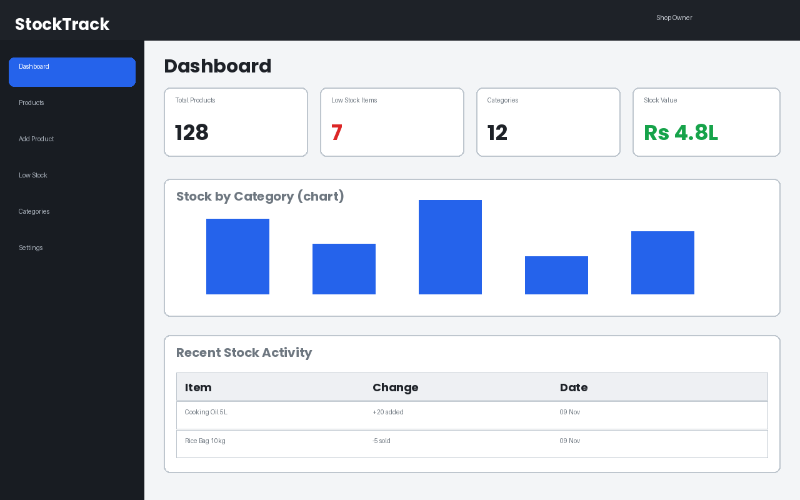
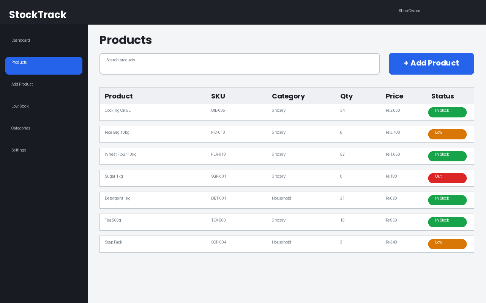
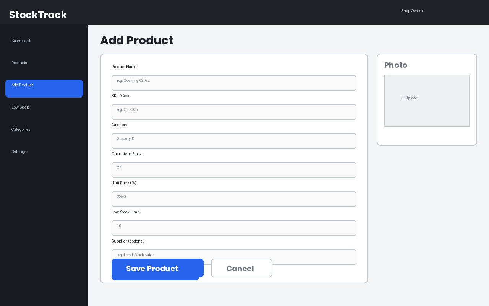
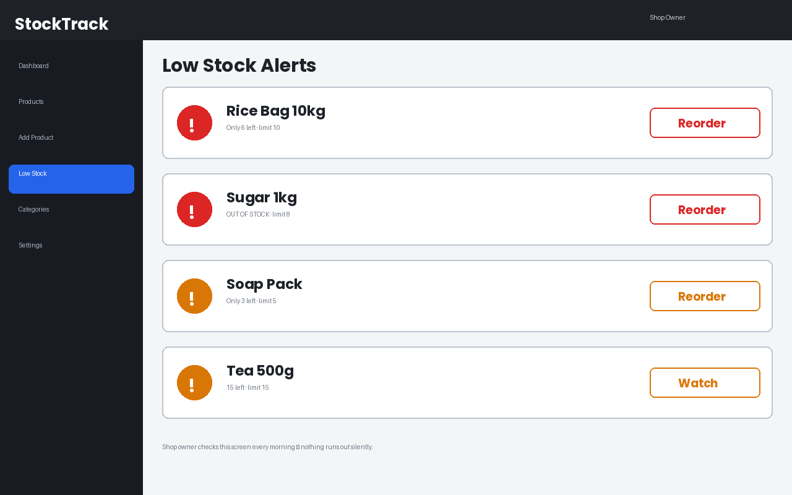

# StockTrack — Inventory Tracker for Small Shops

A full-stack web application built during the **NextByte Studio Full-Stack Web Development Internship** (8 weeks, Nov 2026 – Jan 2027).

**Intern:** Abdul Malik
**Track:** Full-Stack Web Development
**Current status:** Week 3 — Backend API ✅

---

## 1. The User Problem

Small shopkeepers in Pakistan (kiryana stores, general stores, small wholesalers) still track their stock in paper registers or from memory. This causes real, everyday losses:

- **Items run out silently** — a shopkeeper only discovers a product is finished when a customer asks for it, and the sale is lost.
- **No clear stock picture** — nobody knows exactly how much of each item is in the shop, or what the total stock is worth.
- **Dead stock piles up** — slow items keep getting reordered while fast items are under-stocked.
- **No history** — when stock goes missing or a count looks wrong, there is no record of what was added or sold.

**StockTrack** solves this with a simple web app where a shop owner can record every product, update quantities as stock comes in and goes out, and get a clear **low-stock alert** before an item runs out.

## 2. Who It Is For

- Owner of a small retail shop (single user, one shop)
- No technical background assumed — the design is deliberately simple, with big clear buttons and plain labels

## 3. Main Features (planned)

1. **Dashboard** — total products, low-stock count, total stock value, recent activity
2. **Product management** — add, edit, delete products (name, SKU, category, quantity, price, supplier)
3. **Stock status** — every product is automatically marked *In Stock / Low / Out of Stock* by comparing quantity with a per-product low-stock limit
4. **Low-stock alerts screen** — one list the owner checks every morning
5. **Search & filter** — find a product by name/SKU, filter by category
6. **Login** — the owner's data is private to their account (Week 6)

## 4. Screen Sketches (Week 1)

### 4.1 Dashboard


### 4.2 Products List


### 4.3 Add / Edit Product


### 4.4 Low-Stock Alerts


## 5. Data Entities

### User
| Field | Type | Notes |
|---|---|---|
| _id | ObjectId | primary key |
| name | String | shop owner's name |
| email | String | unique, used for login |
| passwordHash | String | never stored in plain text |
| shopName | String | name of the shop |
| createdAt | Date | |

### Category
| Field | Type | Notes |
|---|---|---|
| _id | ObjectId | primary key |
| name | String | e.g. Grocery, Household |
| userId | ObjectId → User | owner of the category |

### Product
| Field | Type | Notes |
|---|---|---|
| _id | ObjectId | primary key |
| name | String | e.g. Cooking Oil 5L |
| sku | String | shop's own code, unique per user |
| categoryId | ObjectId → Category | |
| quantity | Number | units currently in stock |
| unitPrice | Number | price in PKR |
| lowStockLimit | Number | alert when quantity ≤ this |
| supplier | String | optional |
| userId | ObjectId → User | owner of the product |
| createdAt / updatedAt | Date | |

### StockMovement (history)
| Field | Type | Notes |
|---|---|---|
| _id | ObjectId | primary key |
| productId | ObjectId → Product | |
| change | Number | +20 (stock in) or −5 (sold) |
| reason | String | purchase / sale / correction |
| createdAt | Date | |

**Relationships:** one User has many Categories and Products; one Category has many Products; one Product has many StockMovements. A product's status is *computed* (not stored): `quantity = 0 → Out`, `quantity ≤ lowStockLimit → Low`, otherwise `In Stock`.

## 6. API Flow (planned REST API)

Base URL: `/api` — all responses are JSON; errors return a consistent shape:
`{ "error": "message" }` with a suitable HTTP status code.

| Method | Endpoint | Purpose |
|---|---|---|
| POST | /api/auth/register | create account |
| POST | /api/auth/login | login, receive token |
| GET | /api/products | list products (search + category filter) |
| POST | /api/products | add a product |
| GET | /api/products/:id | one product |
| PUT | /api/products/:id | edit a product |
| DELETE | /api/products/:id | delete a product |
| POST | /api/products/:id/stock | record stock in/out (creates a StockMovement) |
| GET | /api/products/low-stock | products at/below their limit |
| GET | /api/categories | list categories |
| POST | /api/categories | add a category |
| GET | /api/dashboard | totals: products, low-stock count, stock value, recent activity |

**Example flow — selling an item:**
```
Shop owner opens Products → taps "−" on Rice Bag (or Stock Out form)
   → Frontend: POST /api/products/:id/stock  { change: -5, reason: "sale" }
   → Backend validates (quantity cannot go below 0)
   → Product.quantity updated + StockMovement saved (one database step)
   → Response: updated product with new status
   → UI refreshes the row; if it crossed the limit, it appears on Low-Stock screen
```

## 7. Tech Stack

- **Frontend:** React + Vite, plain CSS (responsive layout)
- **Backend:** Node.js + Express (REST API)
- **Database:** MongoDB (Mongoose models)
- **Auth:** JWT in an httpOnly header flow, passwords hashed with bcrypt
- **Tools:** Git + GitHub, VS Code

## 8. Project Structure

```
nextbyte-fullstack-internship/
├── README.md          ← this file (planning + documentation)
├── screens/           ← Week 1 screen sketches + later screenshots
├── client/            ← React frontend (from Week 2)
└── server/            ← Express + MongoDB backend (from Week 3)
```

## 9. 8-Week Roadmap (per internship plan)

| Week | Task | Status |
|---|---|---|
| 1 | Planning & repository setup | ✅ This week |
| 2 | Frontend foundation (UI, components, demo data) | ✅ Done |
| 3 | Backend API (endpoints, validation, error handling) | ✅ Done |
| 4 | Database & full CRUD | ⏳ |
| 5 | Connect frontend & backend | ⏳ |
| 6 | Authentication & quality pass | ⏳ |
| 7 | Deployment & integration | ⏳ |
| 8 | Final release (README, demo, screenshots) | ⏳ |

## 10. Week 2 — Frontend Foundation ✅

Built the complete StockTrack frontend in `client/` (React + Vite, plain CSS):

- **Pages** — Dashboard (stat cards + needs-attention list), Products (search by name/SKU + category filter), Add/Edit Product form, Low-Stock Alerts table
- **Reusable components** — `Navbar`, `ProductCard`, `LowStockBadge`, `SearchBar`, `StatCard`
- **Demo data** — 8 kiryana products in `client/src/data/demoProducts.js`, matching the Product entity in section 5. Status is computed, never stored: quantity 0 → *Out of Stock*, quantity ≤ lowStockLimit → *Low Stock*, otherwise *In Stock* (`client/src/utils/stockStatus.js`)
- **Add/Edit/Delete** work against the in-memory demo data (no backend yet — the API arrives in Week 3)
- **Product photos** — real photo files in `client/src/assets/`, imported in code, one per product (sources and licences listed in `client/src/assets/README.txt`)
- **Responsive** — layout works on desktop and down to 360px phone width

Client folder structure:

```
client/
├── index.html
├── vite.config.js
└── src/
    ├── main.jsx / App.jsx      ← entry + page state & navigation
    ├── index.css               ← all styling (plain CSS)
    ├── data/demoProducts.js    ← demo products + categories
    ├── utils/stockStatus.js    ← computed stock status helpers
    ├── components/             ← Navbar, ProductCard, LowStockBadge, SearchBar, StatCard
    ├── pages/                  ← Dashboard, Products, ProductForm, LowStock
    └── assets/                 ← product photos (imported by demoProducts.js)
```

## 11. Week 3 — Backend API ✅

Built the StockTrack REST API in `server/` (Node.js + Express). All endpoints from section 6 are implemented — except auth (`/api/auth/register`, `/api/auth/login`), which is planned for Week 6.

**How it works:**

- **In-memory data store** (`server/src/data/store.js`) — plain JS arrays seeded with the same 8 products and 6 categories as the Week 2 frontend demo data, so both sides match exactly. Restarting the server resets the data to the seed state. MongoDB + Mongoose arrive in **Week 4**; JWT auth arrives in **Week 6**.
- **Computed status** — every product in every response carries a `status` field computed from quantity and low-stock limit (never stored), mirroring `client/src/utils/stockStatus.js`.
- **Validation** — invalid input returns `400` (see rules below); a duplicate SKU or category name returns `409`; an unknown product id or route returns `404`.
- **Consistent errors** — every error, including malformed JSON bodies and unknown routes, returns the same JSON shape, never an HTML error page:

```json
{ "error": "Stock cannot go below 0 (current quantity is 2, change is -50)" }
```

**How to run:**

```bash
cd server
npm install
npm start          # or: npm run dev  (restarts on file changes)
```

The API listens on `http://localhost:5000` (set the `PORT` environment variable to change it). Quick check: open `http://localhost:5000/api/health` → `{ "status": "ok" }`.

**Endpoints (as implemented):**

| Method | Endpoint | Notes |
|---|---|---|
| GET | /api/health | `{ "status": "ok" }` |
| GET | /api/products | All products with computed `status`. Optional `?search=` matches name or SKU; optional `?category=` filters by exact category name (both can combine) |
| POST | /api/products | Creates a product → `201`. Body: `name`, `sku`, `category`, `quantity`, `unitPrice`, `lowStockLimit` (required), `supplier` (optional) |
| GET | /api/products/low-stock | Products that are *Low Stock* or *Out of Stock* |
| GET | /api/products/:id | One product → `404` if the id does not exist |
| PUT | /api/products/:id | Updates only the fields sent; same validation as POST |
| DELETE | /api/products/:id | Deletes the product and returns it |
| POST | /api/products/:id/stock | Body: `{ "change": -5, "reason": "sale" }`. `change` must be a non-zero integer and the quantity can never go below 0. Records a StockMovement and returns the updated product |
| GET | /api/categories | All categories |
| POST | /api/categories | Body: `{ "name": "Frozen" }` → `201`; duplicate name → `409` |
| GET | /api/dashboard | `{ totalProducts, lowStockCount, outOfStockCount, totalStockValue, recentActivity }` — recentActivity is the latest 5 stock movements, newest first |
| POST | /api/auth/register, /api/auth/login | ⏳ Planned for Week 6 (not implemented yet) |

**Validation rules (products):** `name`, `sku` and `category` must be non-empty strings; `sku` must be unique; `quantity` and `lowStockLimit` must be integers ≥ 0; `unitPrice` must be a number ≥ 0; `supplier` is an optional string.

**Server folder structure:**

```
server/
├── package.json
└── src/
    ├── index.js                  ← app setup, middleware, route mounting, error handler
    ├── data/store.js             ← in-memory seed data (categories, products, movements)
    ├── utils/stockStatus.js      ← computed stock status helpers
    ├── middleware/errorHandler.js← consistent JSON errors + 404 for unknown routes
    └── routes/                   ← products.js, categories.js, dashboard.js
```

**Evidence:** API screenshots in `screenshots/` — `week3-api-products.png`, `week3-api-low-stock.png`, `week3-api-dashboard.png`.

## 12. How to Run

Frontend (Week 2):

```bash
cd client
npm install
npm run dev
```

Then open the local URL Vite prints (usually http://localhost:5173).

Backend (Week 3):

```bash
cd server
npm install
npm start
```

Then the API is available at http://localhost:5000 (see section 11 for the endpoint documentation). The frontend connects to the API in Week 5.

---

*Built as part of the NextByte Studio internship program. This repository is public as required by the program's submission guidelines.*
